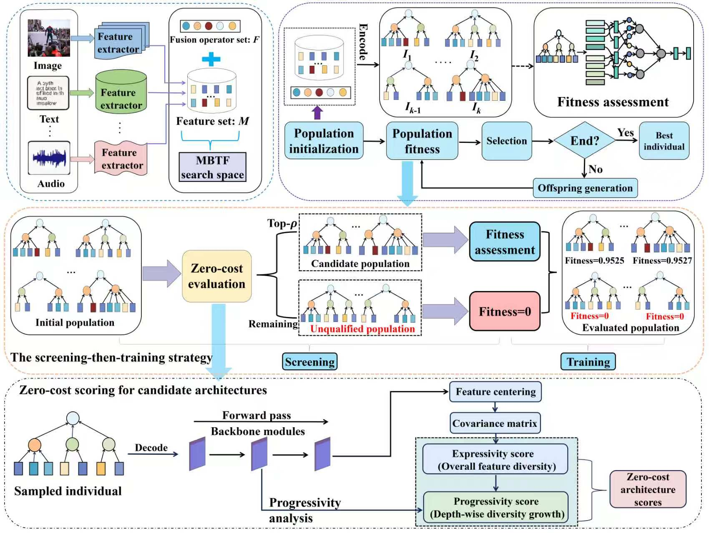

<h2 align="center"> <a href="https://icml.cc/virtual/2026/poster/63057">Multi-Branch Tree-based Fusion Neural Architecture Search with Zero-Cost Screen for Multi-Modal Classification</a></h2>

<div align="center">

**Qian Guo<sup>1</sup>, Quanchen Su<sup>1</sup>, [Xinyan Liang<sup>2*</sup>](https://xinyanliang.github.io/), [Yuhua Qian<sup>2</sup>](http://dig.sxu.edu.cn/qyh/), Nan Li<sup>2</sup>, and Zhihua Cui<sup>1</sup>**

<sup>1</sup>School of Computer Science and Technology and Shanxi Key Laboratory of Big Data Analysis and Parallel Computing, Taiyuan University of Science and Technology, Taiyuan 030024, Shanxi, China.<br>
<sup>2</sup>Institute of Big Data Science and Industry, Key Laboratory of Evolutionary Science Intelligence of Shanxi Province, School of Artificial Intelligence, Shanxi University, Taiyuan 030006, Shanxi, China.<br>

<sup>*</sup>Corresponding author: Xinyan Liang ([liangxinyan48@163.com](mailto:liangxinyan48@163.com)).


</div>


## Abstract
Multi-modal classification (MMC) leverages effective fusion of information from diverse modalities to achieve superior classification performance. Existing fusion methods, however, rely on expert-designed architectures that demand substantial domain expertise and computational resources, with fixed topologies that offer limited structural flexibility across tasks and datasets. Although neural architecture search (NAS)-based fusion methods have been proposed to automatically discover high-performing architectures, these approaches are computationally expensive and predominantly rely on pairwise modality combinations, which fail to capture complex multi-variable correlations, limiting the architectures' expressiveness and flexibility. Consequently, there remains a lack of multi-modal fusion frameworks that can simultaneously achieve high efficiency and high accuracy.
To break through these bottlenecks, we propose a multi-branch tree-based fusion neural architecture search framework (MBTF-NAS). For performance enhancement, MBTF-NAS employs a multi-branch tree-structured encoding strategy that enables dynamic and computationally efficient exploration of fusion topologies and substantially strengthens cross-modal interaction. A learnable model-level attention weighting mechanism further emphasizes informative modalities, improving the overall quality of multi-modal feature fusion. For efficiency improvement, MBTF-NAS leverages zero-cost proxy metrics for architecture evaluation, enabling rapid identification of high-potential candidates while dramatically reducing computational overhead. 
We conducted a comprehensive evaluation of MBTF-NAS on seven representative multi-modal benchmarks.
The experimental results demonstrate that MBTF-NAS consistently outperforms state-of-the-art approaches, highlighting its effectiveness and generalizability.
## 🏗️Model
<div align="center">
  
</div>


## 🖥️ Computing Environment

The experiments were conducted on a workstation running Ubuntu 22.04.5 LTS, equipped with an AMD EPYC 7763 64-Core Processor, 503 GB of memory, and 8 NVIDIA GeForce RTX 4090 GPUs, each with 24 GB of VRAM.

## 🧪 Experimental Setup

All reproduced experiments were implemented using TensorFlow 2.5.0. The software environment was based on Python 3.7.0, CUDA runtime 11.0, and cuDNN 8.

To facilitate reproducibility, the common implementation settings for MBTF-NAS are summarized below. Unless otherwise specified, the following default settings are used:

| Parameter | Default value |
| :--- | :--- |
| Batch size | 256 |
| Maximum training epochs | 150 |
| Early-stopping patience | 20 epochs |
| Crossover rate | 0.9 |
| Mutation rate | 0.2 |
| Retained ratio in top-$\rho$ zero-cost screening | $\rho = 0.6$ |

Other dataset-specific settings are provided in the corresponding dataset-specific experimental analyses.

  

## 🎞️ Experiments

We evaluate MBTF-NAS on seven multi-modal and multi-view benchmarks to assess its classification performance, search efficiency, and generalization across diverse tasks. The experiments also examine the contributions of multi-branch tree encoding, learnable modality weights, and zero-cost screening.

### 1 Data

#### 1.1 Multi-Modal and Multi-View Datasets

The datasets used in our experiments are summarized below. The links point to the source datasets or their associated project pages.

| Dataset | Task | Source |
| :--- | :--- | :--- |
| HARM-P | Harmful meme classification | [MOMENTA project](https://github.com/LCS2-IIITD/MOMENTA) |
| HARM-C | Harmful meme classification | [MOMENTA project](https://github.com/LCS2-IIITD/MOMENTA) |
| NUS-WIDE-128 | Multi-view image classification | [Dataset page](https://v2.imag-njust.net/resource/NUS-wide/) |
| EgoGesture | Egocentric hand gesture recognition | [Dataset page](https://nlpr.ia.ac.cn/iva/yfzhang/datasets/egogesture.html) |
| NTU RGB-D | Human action recognition | [Dataset page](https://rose1.ntu.edu.sg/dataset/actionRecognition/) |
| MM-IMDB | Multi-label movie genre classification | [Dataset project](https://github.com/johnarevalo/gmu-mmimdb) |
| MV-RML2016.10a | Automatic modulation classification | [Source RadioML dataset](https://www.deepsig.ai/datasets/) |

#### 1.2 Data Preparation

Our experiments use the dataset-specific feature representations, data splits, and evaluation protocols described in the paper.

- **HARM-P and HARM-C:** Prepare the image and text representations and the corresponding labels for the binary and three-class classification settings.
- **NUS-WIDE-128:** Use the single-label subset and multi-view feature representations specified in the paper.
- **EgoGesture:** Prepare the RGB and depth features following the cross-subject evaluation protocol.
- **NTU RGB-D:** Prepare the video and skeleton features following the evaluation protocol described in the paper.
- **MM-IMDB:** Prepare the movie poster and plot description features, retaining the multi-label annotations for the 23 selected genres.
- **MV-RML2016.10a:** Construct the multi-view representations from RadioML 2016.10a using features extracted by AWN, MCLDNN, ResNet, LSTM, and GRU.

Ensure that feature arrays from different modalities or views are aligned with the same sample order and labels.

### 2 Experimental Workflow

MBTF-NAS automatically searches for effective multi-modal fusion architectures using multi-branch tree encoding, learnable modality weights, and a screening-then-training evaluation strategy. The overall procedure is as follows:

- Step 1: Prepare the multi-modal features and labels, and organize the training, validation, and test splits according to the experimental protocol of each dataset.
- Step 2: Randomly initialize a population of multi-branch fusion trees, where leaf nodes represent modality inputs and internal nodes represent fusion operators.
- Step 3: Decode each candidate tree into a fusion network with feature projection layers and learnable modality weights.
- Step 4: Compute expressivity and progressivity scores for randomly initialized candidate networks, and aggregate the two proxy rankings to obtain a zero-cost ranking score.
- Step 5: Train only the top-ranked candidates selected by the top-$\rho$ screening strategy, and evaluate their validation performance as fitness. Assign zero fitness to the remaining candidates without training.
- Step 6: Generate offspring through tournament selection, subtree crossover, and node-level mutation. Repeat zero-cost screening and training-based evaluation, and retain the best individuals for the next generation.
- Step 7: Select the best fusion network after the final generation and evaluate its performance on the held-out test set.

#### 2.1 Data Preparation

The experiments cover seven multi-modal benchmarks:

- HARM-P
- HARM-C
- NUS-WIDE-128
- EgoGesture
- NTU RGB-D
- MM-IMDB
- MV-RML2016.10a

For each dataset, prepare the corresponding modality features and labels. Ensure that samples from different modalities are aligned and that the feature arrays follow the same sample order.

Use the dataset-specific splits, feature representations, and evaluation protocols described in the paper. For MM-IMDB, preserve the multi-label annotations required for movie genre classification.

#### 2.2 Multi-Branch Fusion Architecture Construction

Each candidate architecture is represented as a multi-branch tree. Internal nodes can combine two or more child representations, allowing flexible fusion topologies across multiple modalities.

The supported fusion operators include:

- Concatenation
- Addition
- Multiplication
- Maximum
- Average

During decoding, modality features are projected into a common feature dimension and weighted using learnable modality weights. The tree is evaluated recursively from its leaves to the root to obtain the final fused representation for classification.

#### 2.3 Zero-Cost Screening and Candidate Training

Before training, each candidate network is evaluated under random initialization using synthetic Gaussian inputs. Expressivity measures feature diversity, while progressivity measures its growth across network depth.

The two proxy rankings are combined using the population-wise log-rank strategy. Only the top $\lceil \rho M \rceil$ candidates are selected for training, where $M$ is the size of the candidate population.

By default, $\rho = 0.6$, meaning that approximately 60% of candidates proceed to training. The remaining candidates receive zero fitness without training.

Selected candidates are trained on the training split and evaluated on the validation split to obtain their fitness values.

#### 2.4 Evolutionary Search

Binary tournament selection is used to select parents. Subtree crossover exchanges substructures between parent trees, while node-level mutation modifies fusion operators or modality inputs.

After evaluating the offspring, the parent and offspring populations are combined, and the top $N$ individuals are retained for the next generation.

Previously evaluated architectures are cached to avoid repeated evaluation, and candidate training tasks are parallelized to improve search efficiency.

#### 2.5 Final Evaluation

After the specified number of generations, the individual with the highest fitness is selected as the final fusion network.

The selected model is evaluated on the held-out test set using the dataset-specific metrics described in the paper.


## 📑Citation
If you find this repository useful, please cite our paper:
```
@article{SuMBTF,
  title={Multi-branch tree-based fusion neural architecture search with zero-cost screen for multi-modal classification},
  author={Guo, Qian and Su, Quanchen and Liang, Xinyan and Qian, Yuhua and Li, Nan and Cui, Zhihua},
  journal={IEEE Transactions on Image Processing}, 
  year={2026},
  volume={35},
  pages={7192--7205},
}
```


## 🔬 Related Work
We list below the works most relevant to this paper, including but not limited to the following:<br>
**_Our research group [[link]](https://xinyanliang.github.io/publications/)_**
- Evolutionary deep fusion method and its application in chemical structure recognition, _IEEE TEVC21_, [[paper]](https://ieeexplore.ieee.org/document/9373673)
- GFD-EMVC: Evolutionary Multi-View Classification with Label Noise via Gradient and Feature Dual-Perception, _ICML26_, [[paper]](https://github.com/LiShuailzn/ICML-2025-Spotlight)
- Improving evolutionary multi-view classification via eliminating individual fitness bias, _NeurIPS25_, [[paper]](https://github.com/LiShuailzn/Neurips-2025-EFB-EMVC)
- Trusted multi-view classification via evolutionary multi-view fusion, _ICLR25_, [[paper]](https://openreview.net/pdf?id=M3kBtqpys5)
- DC-NAS: Divide-and-conquer neural architecture search for multi-modal classification, _AAAI24_, [[paper]](https://ojs.aaai.org/index.php/AAAI/article/view/29281)
- Core-structures-guided multi-modal classification neural architecture search, _IJCAI24_, [[paper]](https://www.ijcai.org/proceedings/2024/0440.pdf)
- CoMO-NAS: Core-structures-guided multi-objective neural architecture search for multi-modal classification, _ACM MM24_, [[paper]](https://dl.acm.org/doi/10.1145/3664647.3681351)
- A fast neural architecture search method for multi-modal classification via knowledge sharing, _IJCAI25_, [[paper]](https://www.ijcai.org/proceedings/2025/557)
- Multi-scale features are effective for multi-modal classification: An architecture search viewpoint, _IEEE TCSVT25_, [[paper]](https://ieeexplore.ieee.org/document/10700772)
- Core structure-guided multi-modal classification via monte carlo tree search, _IJMLC25_, [[paper]](https://link.springer.com/article/10.1007/s13042-025-02606-z)
- LogicNAS: Multi-view neural architecture search method for image sequence logic prediction, _IEEE TETCI25_, [[paper]](https://ieeexplore.ieee.org/document/11262275)

<!-- ## 🙏 Acknowledgement -->


## 📬Contact
If you have any detailed questions or suggestions, you can email us: [suquanchen2025@163.com](mailto:suquanchen2025@163.com)
